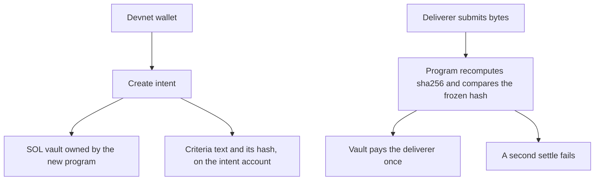

# INTENT PROTOCOL

**Freeze the rules before work. Prove the outcome after work.**

People who pay for work and people who do the work still end up arguing about what “done” meant, because that rule was never frozen before the work started. Intent Protocol freezes the done-criteria first, escrows the reward, and lets the Solana program — not the deliverer — decide whether the submission earned it. On devnet, one frozen receipt can be settled once: a matching submission pays the vault, and a second settle is rejected.

Earned is a protocol fact. Paid is a separate event. There is no mainnet deployment and no protocol token. The public demo uses devnet SOL only.

The judge brief is [HACKATHON.md](HACKATHON.md). Internal gate history is [docs/GOVERNANCE-LEDGER.md](docs/GOVERNANCE-LEDGER.md).

## Try the devnet demo

The public app is [hackathon-demo/](hackathon-demo/). It talks only to `https://api.devnet.solana.com`. It asks a browser wallet to sign. It never asks for a secret key.

```bash
cd hackathon-demo
npm ci
npm run dev
# http://127.0.0.1:4173
```

Onboarding, in the page: install Phantom or Solflare, switch the wallet to Devnet, airdrop 1 SOL (or use [faucet.solana.com](https://faucet.solana.com)), then use the sample intent. The sample done-criteria is the decimal sum of 17 and 25. The answer that earns the escrow is `42`. The sample locks 0.05 SOL.

Production deploy is a static Vite build. From a logged-in Vercel CLI, at this repository root:

```bash
npx vercel --prod
```

`vercel.json` installs and builds only `hackathon-demo/`. Do not add environment variables. There are no secrets.

## How Solana is used



| What | Where |
|---|---|
| New hackathon program id (pinned; see deploy note) | [`7a6K1mJVu3vx2RugjYxtfipPGFvqygghD1wTox7bBa2F`](https://explorer.solana.com/address/7a6K1mJVu3vx2RugjYxtfipPGFvqygghD1wTox7bBa2F?cluster=devnet) |
| Immutable TESTNET-R1 program, unchanged | [`ASvnm4pic6a9UDud3CqY51xUfhys5t7mqYrcHbJkDW4F`](https://explorer.solana.com/address/ASvnm4pic6a9UDud3CqY51xUfhys5t7mqYrcHbJkDW4F?cluster=devnet) |

On 2026-10-25, `getAccountInfo` for `7a6K1m…` on `https://api.devnet.solana.com` was null. The binary is built, and the same program id on a local test validator completed create, reject `41` (custom 207), settle `42`, reject a second settle (custom 208), and cancel. Public devnet airdrop for the deployer returned 429, so the account is not on devnet yet. The one remaining deploy step is in [HACKATHON.md](HACKATHON.md). Do not describe this id as a live devnet program until that account is executable.

The new program stores, for each intent:

- the done-criteria text and `sha256` of that text
- `sha256` of the expected submission, not the answer itself
- the escrowed lamports in a program-owned vault
- the submission, its hash, and a verification-result hash after a pass
- status: funded, delivered, verified, settled, or cancelled

`verify` fails closed. A wrong submission does not move the SOL. The creator can cancel before verification and take the escrow back. `settle` transfers the escrow to the deliverer who submitted, and only from the verified state.

The September program is a different, frozen proof: one pre-authorized receipt, 10 test tokens, exactly once. It is immutable (`upgrade authority = null`). This hackathon does not upgrade it. Its proof transactions:

- The one successful release: [`3enZzgSBb14E6DS7kRPrTPtTeVZUpdx3HVYFYyGdnRQ4ThCWrQDHPoPJedeXcEa75t79pTz4hkVneqkK15fSrFEZ`](https://explorer.solana.com/tx/3enZzgSBb14E6DS7kRPrTPtTeVZUpdx3HVYFYyGdnRQ4ThCWrQDHPoPJedeXcEa75t79pTz4hkVneqkK15fSrFEZ?cluster=devnet)
- The same reward retried, rejected with custom error 108: [`5wkM67bRLUPUMSEJcyrB465wFZ1FG3hSdBW29ffb5RKwTtMZBMUsSPSmc82rxB9544gg5f2zK8aLP4w7xZUjTYGp`](https://explorer.solana.com/tx/5wkM67bRLUPUMSEJcyrB465wFZ1FG3hSdBW29ffb5RKwTtMZBMUsSPSmc82rxB9544gg5f2zK8aLP4w7xZUjTYGp?cluster=devnet)

Re-read on 2026-10-25 from the public devnet RPC: that program is still executable, its upgrade authority is still null, the successful transaction still has no error, and the retries still fail with custom 108.

## Check a bundle offline

These commands need Node.js 22 or newer. They do not need a wallet or a network connection. Run them from a clone.

```bash
# Local golden path from before the hackathon. Expect: 710/710 checks passed
cp -a packages/gp5-proof-pack/pack /tmp/intent-gp5-pack
cd /tmp/intent-gp5-pack && node verify.mjs

# The September devnet settlement pack. Expect: 54/54 checks passed
cd - >/dev/null
cp -a packages/solana-devnet-adapter/t5-proof-pack /tmp/intent-t5-pack
cd /tmp/intent-t5-pack && node verify.mjs
```

Copy the pack directory onto a machine that does not have the rest of the repository. `node verify.mjs` from inside that directory is the whole check. The devnet pack recomputes the signed transaction and the receipt hash offline. It labels chain inclusion as evidence that was observed when the pack was built. It does not phone home.

The portable experiment verifier, for a future real-user pack, is pinned outside the pack:

```bash
shasum -a 256 packages/user-evidence-r0/src/portable-replay.mjs
# sha256:292d580430dbe39c2978060340d2e4d27dd8debcfc807ba5f0a5e6157cbc8493
```

This repository does not contain a real-user experiment pack. Real payers, real tasks, and real external workers recorded here: 0.

## Built during the hackathon

Encode Club Solana Hackathon 2026 runs 2026-10-12 through 2026-11-08. Work in this repository before 2026-10-12 is pre-existing. The notes below are the split.

**Before 2026-10-12**

- The off-chain protocol and the local golden path (GP0–GP5), including the third-party proof pack.
- Solana devnet settlement for one frozen receipt: program `ASvnm4pi…`, deployed and proven in late September 2026, then made immutable.
- The loopback experiment UI and the portable verifier (2026-10-03).
- The repository health workflow (2026-10-11).

**2026-10-12 through 2026-10-24, still before this product gap**

- Product copy and the local experiment UI’s expression layer.
- Recruitment attempts. No completed external experiment.
- CI runner repairs. No new Solana program.

**From 2026-10-25, for the 2026-11-01 checkpoint**

- A new program, `7a6K1m…`, for open intents: on-chain criteria hash, SOL escrow at creation, program-checked delivery, exactly-once settlement. Proven on a local validator on 2026-10-25. Not on devnet yet; the faucet rate-limited this environment. The immutable program was not modified.
- This public wallet demo, the judge brief, the demo script, and the submission fields.
- x402 was evaluated and not implemented. The track we recommend is Best Consumer App on Solana. Reasoning: [docs/ENCODE-SUBMISSION.md](docs/ENCODE-SUBMISSION.md).

## Map

| Doc | What it is |
|---|---|
| [HACKATHON.md](HACKATHON.md) | Judge brief and deploy notes |
| [docs/DEMO-SCRIPT.md](docs/DEMO-SCRIPT.md) | 3-minute English narration |
| [docs/ENCODE-SUBMISSION.md](docs/ENCODE-SUBMISSION.md) | Paste-ready form fields and track recommendation |
| [docs/product/OVERVIEW.md](docs/product/OVERVIEW.md) | Product narrative |
| [docs/GOVERNANCE-LEDGER.md](docs/GOVERNANCE-LEDGER.md) | Internal approval ledger, moved out of this page |
