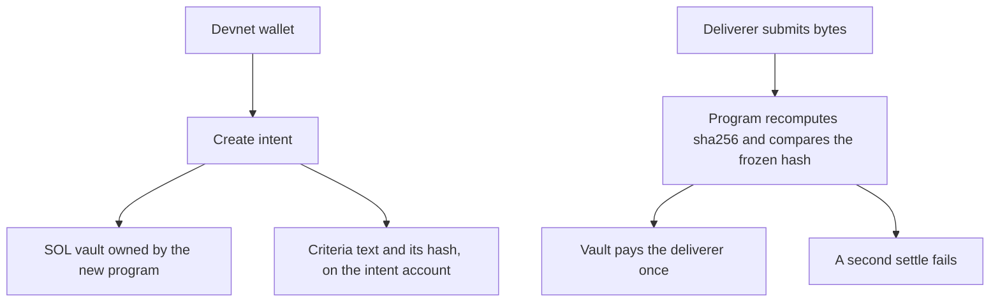

# INTENT PROTOCOL

**A safer way to pay for work.**

Hire work without moving the goalposts. Freeze the rules before the work. Prove the outcome after.

On the public devnet demo, the pay is locked together with the rule. A matching delivery is paid once. A wrong delivery is not paid. There is no mainnet deployment and no token. Real external payer, task, and worker recorded here: 0.

The judge brief is [HACKATHON.md](HACKATHON.md). Internal gate history is [docs/GOVERNANCE-LEDGER.md](docs/GOVERNANCE-LEDGER.md).

## Try the devnet demo

The public app is live at [https://intent-protocol-wine.vercel.app](https://intent-protocol-wine.vercel.app). HTTP 200 was checked on 2026-10-25. It talks only to `https://api.devnet.solana.com`. It asks a browser wallet to sign. It never asks for a secret key. The judge deck is [hackathon-demo/public/slides.html](hackathon-demo/public/slides.html), served at `/slides.html` on that site once this file is in the production build.

The same app runs locally:

```bash
cd hackathon-demo
npm ci
npm run dev
# http://127.0.0.1:4173
```

Onboarding, in the page: install Phantom, switch the wallet to Devnet (Solana’s free practice network), get practice SOL, then post the sample bounty. Northwind Coffee is hiring a writer for one homepage headline. The agreed line is `Northwind Coffee: order ahead, skip the line.` A shorter line does not get paid. The pay locked with the bounty is 0.05 practice SOL.

Production is already that Vercel URL. A later static rebuild, from a logged-in Vercel CLI at this repository root:

```bash
npx vercel --prod
```

`vercel.json` installs and builds only `hackathon-demo/`. Do not add environment variables. There are no secrets.

## How Solana is used



| What | Where |
|---|---|
| Hackathon escrow, on devnet | [`7a6K1mJVu3vx2RugjYxtfipPGFvqygghD1wTox7bBa2F`](https://explorer.solana.com/address/7a6K1mJVu3vx2RugjYxtfipPGFvqygghD1wTox7bBa2F?cluster=devnet) |
| Immutable TESTNET-R1 program, unchanged | [`ASvnm4pic6a9UDud3CqY51xUfhys5t7mqYrcHbJkDW4F`](https://explorer.solana.com/address/ASvnm4pic6a9UDud3CqY51xUfhys5t7mqYrcHbJkDW4F?cluster=devnet) |

Re-read on 2026-10-25 from `https://api.devnet.solana.com`: `7a6K1m…` is deployed and executable. Program data [`4R5a3NYMFwaP6bK6GTvfcTpNnx3Nvm6tGagy5AyCJxm3`](https://explorer.solana.com/address/4R5a3NYMFwaP6bK6GTvfcTpNnx3Nvm6tGagy5AyCJxm3?cluster=devnet). Upgrade authority `4ZJVcnWWJmAdmqz8Trt334HKbx3geXTf5FMBaX2yjpUT`. Last deployed slot 514886402. Data length 78640 bytes. The program-data account holds 0.40037004 SOL of rent. Deploy transaction: [`3aGkjKFg…bSjx`](https://explorer.solana.com/tx/3aGkjKFgswMQgZVvn6VoZZM2Reyhs7uDTSENp2eqQaqcZVgUp3Ub5J5bCbWruqkk585KjS5NHrubgVWN1pXqbSjx?cluster=devnet). A sample settlement of the public demo’s 0.05 SOL intent: [`64N3e5KB…w6jT`](https://explorer.solana.com/tx/64N3e5KBXaK4Tm5vYmWWvCEWCPSLMwdq1aXSQQeDzzhFTchaaRNTUXh7a5nx4T9YnAcPaFWSkqBo1jXYoDCPw6jT?cluster=devnet). Private keys are not in this repository.

The new program stores, for each intent:

- the done-criteria text and `sha256` of that text
- `sha256` of the expected submission, not the answer itself
- the escrowed lamports in a program-owned vault
- the submission, its hash, and a verification-result hash after a pass
- status: funded, delivered, verified, settled, or cancelled

`verify` fails closed. A wrong submission does not move the SOL. The creator can cancel before verification and take the escrow back. `settle` transfers the escrow to the deliverer who submitted, and only from the verified state.

The September program is a different, frozen proof: one pre-authorized receipt, 10 test tokens, exactly once. It is immutable (`upgrade authority = null`). This hackathon does not upgrade it. Its proof transactions:

- The one successful release: [`3enZzgSBb14E6DS7kRPrTPtTeVZUpdx3HVYFYyGdnRQ4ThCWrQDHPoPJedeXcEa75t79pTz4hkVneqkK15fSrFEZ`](https://explorer.solana.com/tx/3enZzgSBb14E6DS7kRPrTPtTeVZUpdx3HVYFYyGdnRQ4ThCWrQDHPoPJedeXcEa75t79pTz4hkVneqkK15fSrFEZ?cluster=devnet)
- The same reward retried, rejected with custom error 108: [`5wkM67bRLUPUMSEJcyrB465wFZ1FG3hSdBW29ffb5RKwTtMZBMUsSPSmc82rxB9544gg5f2zK8aLP4w7xZUjTYGp`](https://explorer.solana.com/tx/5wkM67bRLUPUMSEJcyrB465wFZ1FG3hSdBW29ffb5RKwTtMZBMUsSPSmc82rxB9544gg5f2zK8aLP4w7xZUjTYGp?cluster=devnet)

Re-read on 2026-10-25 from the public devnet RPC: that program is still executable, its upgrade authority is still null, the successful transaction still has no error, and the retries still fail with custom 108.

## Check a bundle offline

These commands need Node.js 22 or newer. They do not need a wallet or a network connection. Run them from a clone.

```bash
# Local golden path from before the hackathon. Expect: 710/710 checks passed
cp -a packages/gp5-proof-pack/pack /tmp/intent-gp5-pack
cd /tmp/intent-gp5-pack && node verify.mjs

# The September devnet settlement pack. Expect: 54/54 checks passed
cd - >/dev/null
cp -a packages/solana-devnet-adapter/t5-proof-pack /tmp/intent-t5-pack
cd /tmp/intent-t5-pack && node verify.mjs
```

Copy the pack directory onto a machine that does not have the rest of the repository. `node verify.mjs` from inside that directory is the whole check. The devnet pack recomputes the signed transaction and the receipt hash offline. It labels chain inclusion as evidence that was observed when the pack was built. It does not phone home.

The portable experiment verifier, for a future real-user pack, is pinned outside the pack. It re-executes untrusted code only inside Docker containers from a pinned image, and refuses to replay when Docker is unavailable (SECURITY-R1-AMENDMENT-2 in [docs/AMENDMENTS.md](docs/AMENDMENTS.md)):

```bash
shasum -a 256 packages/user-evidence-r0/src/portable-replay.mjs
# sha256:5345ed1e9d269c9b3e6270a030a78f6e74457f37287dffd6acdbcb12789ab217
```

This repository does not contain a real-user experiment pack. Real payers, real tasks, and real external workers recorded here: 0.

## Built during the hackathon

Encode Club Solana Hackathon 2026 runs 2026-10-12 through 2026-11-08. Work in this repository before 2026-10-12 is pre-existing. The notes below are the split.

**Before 2026-10-12**

- The off-chain protocol and the local golden path (GP0–GP5), including the third-party proof pack.
- Solana devnet settlement for one frozen receipt: program `ASvnm4pi…`, deployed and proven in late September 2026, then made immutable.
- The loopback experiment UI and the portable verifier (2026-10-03).
- The repository health workflow (2026-10-11).

**2026-10-12 through 2026-10-24, still before this product gap**

- Product copy and the local experiment UI’s expression layer.
- Recruitment attempts. No completed external experiment.
- CI runner repairs. No new Solana program.

**From 2026-10-25, for the 2026-11-01 checkpoint**

- A new program, `7a6K1m…`, for open intents: on-chain criteria hash, SOL escrow at creation, program-checked delivery, exactly-once settlement. Deployed to devnet on 2026-10-25. The immutable program was not modified.
- The public wallet demo at `https://intent-protocol-wine.vercel.app`, the judge brief, the slide deck, the demo script, and the submission fields.
- The Encode track is Best Consumer App on Solana. x402 is not entered. Reasoning: [docs/ENCODE-SUBMISSION.md](docs/ENCODE-SUBMISSION.md).

## Map

| Doc | What it is |
|---|---|
| [HACKATHON.md](HACKATHON.md) | Judge brief and deploy notes |
| [docs/DEMO-SCRIPT.md](docs/DEMO-SCRIPT.md) | Finals shot list for the Northwind Coffee bounty |
| [hackathon-demo/public/INTENT-Encode-demo.mp4](hackathon-demo/public/INTENT-Encode-demo.mp4) | Earlier video, arithmetic sample, 104 seconds |
| [docs/ENCODE-SUBMISSION.md](docs/ENCODE-SUBMISSION.md) | Paste-ready form fields and track recommendation |
| [docs/ENCODE-MID-SUBMISSION.md](docs/ENCODE-MID-SUBMISSION.md) | Finals paste fields, deadline 2026-11-09 19:59 Asia/Shanghai |
| [hackathon-demo/public/slides.html](hackathon-demo/public/slides.html) | Judge slide deck |
| [docs/product/OVERVIEW.md](docs/product/OVERVIEW.md) | Product narrative |
| [docs/GOVERNANCE-LEDGER.md](docs/GOVERNANCE-LEDGER.md) | Internal approval ledger, moved out of this page |
